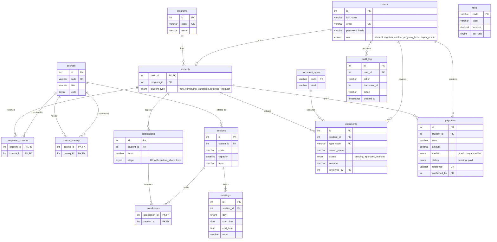

# PTC Fast-Enroll: Entity Relationship Diagram

Paste the diagram below into https://mermaid.live to export it as PNG or SVG for your slides.
(WebStorm's Markdown preview also draws Mermaid diagrams.)

## Why it is in 3NF
- Every non-key column depends on the key, the whole key, and nothing but the key.
- Repeating groups live in their own tables: a section's meeting times are rows in `meetings`, a student's reserved sections are rows in `enrollments`, prerequisites are rows in `course_prereqs`.
- Names and titles are stored once (`programs`, `courses`, `document_types`) and referenced by id.
- Uploaded files are not in the database. Only the stored file name is (`documents.stored_name`).
- The enrollment stage shown to students is computed from documents, enrollments and payments, so it can never disagree with them.
